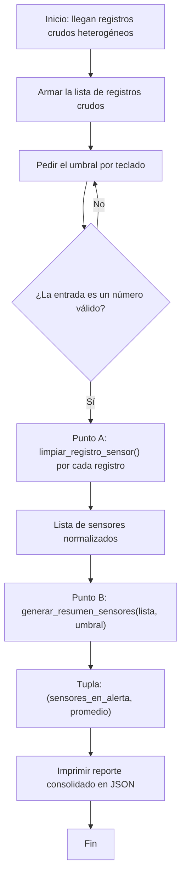

# Ejercicio 1 — Sanitización y Análisis Estadístico de Sensores

> **TP Final COM 2 · EcoTech Solutions**

Los microcontroladores de la planta transmiten lecturas térmicas heterogéneas:
espacios indeseados (`" SENSOR-001 "`), valores mezclados con unidades
(``"24.5C"``) y atributos incompletos (sensores sin ubicación). Este ejercicio
construye el componente que **normaliza esos registros** y genera el
**reporte consolidado** para la toma de decisiones.

---

## Archivos de este ejercicio

| Archivo | Qué contiene |
|---|---|
| `ejercicio_01_sensores.py` | Solución completa: Punto A, Punto B y demo del flujo. |
| `test_ejercicio_01.py` | 19 tests unitarios con `unittest` (librería estándar). |
| `guia_de_estudio.md` | 10 preguntas de repaso tipo parcial, con respuestas plegables. |
| `README.md` | Este documento: conceptos, diseño y modo de uso. |

## Cómo ejecutar

```bash
cd ejercicio_01_sensores

# Demostración completa (pide el umbral por teclado):
python ejercicio_01_sensores.py

# Tests unitarios:
python -m unittest test_ejercicio_01.py -v
```

Requisitos: **Python 3.10 o superior** (se usan type hints modernos como
`float | None`). No hay dependencias externas: todo es librería estándar.

---

## Conceptos clave

### 1. Sanitización vs. normalización

Antes de poder calcular nada, los datos tienen que ser *confiables*. En el
día a día profesional, gran parte del trabajo con datos es justamente esta
etapa de limpieza:

- **Sanitizar** = eliminar lo que no debería estar (espacios sobrantes,
  símbolos pegados, texto basura como `"n/d"`).
- **Normalizar** = llevar lo que queda a un formato canónico y comparable
  (la temperatura siempre es `float`, la ubicación siempre es texto con un
  valor por defecto conocido).

Ambas ideas están dentro de `limpiar_registro_sensor()`: primero se limpia
el valor crudo y después se convierte al tipo definitivo.

### 2. Dos capas con responsabilidades separadas

| Capa | Función | Recibe | Devuelve |
|---|---|---|---|
| **A — Normalización** | `limpiar_registro_sensor()` | UN dict crudo | UN dict nuevo y estandarizado |
| **B — Monitoreo** | `generar_resumen_sensores()` | lista ya limpia + umbral | tupla `(alertas, promedio)` |

Esta separación permite:

- Probar cada capa por separado (los tests lo aprovechan).
- Reutilizar la limpieza en otros reportes que no calculen promedios.
- Cambiar el formato del reporte sin tocar la lógica estadística.

### 3. Funciones puras: no mutar lo que llega

`limpiar_registro_sensor()` **devuelve un diccionario nuevo** en lugar de
modificar el que recibe. Evitar efectos secundarios hace que el código sea
más fácil de razonar y de testear: si algo se rompe, no hay que sospechar de
"quién tocó" los datos originales. Hay un test dedicado a garantizarlo
(`test_no_muta_el_registro_original`).

### 4. Valores por defecto seguros

Cuando falta un dato, el reporte igual tiene que ser legible para quien toma
decisiones. Por eso:

- Ubicación faltante → `"Ubicación no registrada"` (texto explícito, no `null`).
- ID faltante o en blanco → `"SENSOR-DESCONOCIDO"`.
- Temperatura irrecuperable → `None`, y el análisis la **excluye** en lugar
  de romperse o de contarla como 0 (contarla como 0 arrastraría el promedio
  hacia abajo de forma injustificada).

### 5. Umbral estricto

"Superar el umbral" se implementó con `>` (estricto): un sensor en 30.0 °C
con umbral 30.0 **no** dispara alerta. Es una convención, no una verdad
absoluta: lo importante es documentarla y testearla, y así se hizo.

### 6. Estadística mínima: el promedio

El promedio térmico global se calcula como suma de lecturas válidas dividida
por cantidad de lecturas válidas, **en una sola pasada** por la lista
(acumuladores). Se devuelve sin redondear: redondear es una decisión de
*presentación*, y se hace solo al imprimir el reporte.

---

## Transformaciones aplicadas (ejemplos reales del dataset de demo)

| Registro crudo | Resultado normalizado | Regla aplicada |
|---|---|---|
| `"sensor_id": " SENSOR-001 "` | `"SENSOR-001"` | `strip()` recorta espacios de los extremos |
| `"temperatura": "24.5C"` | `24.5` (float) | se descarta el sufijo de unidad |
| `"temperatura": "29,9C"` | `29.9` | coma decimal argentina → punto |
| `"temperatura": "26.4°C"` | `26.4` | se descartan `°` y sufijo |
| `"temperatura": "n/d"` | `null` | lectura irrecuperable → `None` |
| `"ubicacion": ""` (o ausente) | `"Ubicación no registrada"` | valor por defecto seguro |
| `"sensor_id": "   "` (en blanco) | `"SENSOR-DESCONOCIDO"` | identificador de reserva |

---

## Diagrama de flujo del programa



---

## Decisiones de diseño (y sus alternativas)

| Decisión | Alternativa descartada | Por qué se eligió así |
|---|---|---|
| Devolver un dict NUEVO | Mutar el registro recibido | Sin efectos secundarios: más fácil de razonar y testear. |
| Temperatura inválida → `None` | Lanzar excepción / usar 0.0 | Una lectura corrupta no debe tumbar el reporte ni arrastrar el promedio. |
| Umbral estricto `>` | `>=` | Interpretación literal de "superar"; documentada y testada. |
| Promedio sin redondear | Redondear dentro de la función | El cálculo queda puro; el redondeo es tarea de la presentación. |
| `TypedDict` como contrato | `dict[str, Any]` a secas | Documenta la forma del registro y habilita verificación estática. |
| `unittest` de la stdlib | `pytest` | Cero dependencias externas para reproducir el TP en cualquier máquina. |
| Umbral por `input()` validado | Constante fija / `sys.argv` | Lo pidió la consigna; el bucle de validación enseña manejo de I/O robusto. |

---

## Extensiones para seguir practicando

1. **Conversión de unidades**: si la lectura viene en `F`, convertirla a
   Celsius antes de promediar (35.2 °F ≈ 1.8 °C). Hoy el sufijo solo se
   descarta.
2. **Máximo y mínimo** por planta, y sensores fuera de un rango
   (alertas por frío además de por calor).
3. **Persistencia**: guardar el reporte JSON en un archivo con
   `json.dump(..., open("reporte.json", "w", encoding="utf-8"))`.
4. **Sufijos compuestos**: ¿qué pasa si llega `"24.5CAL"`? Hacer el parser
   más estricto con expresiones regulares.
5. **Historial**: en vez de una lectura por sensor, recibir una lista de
   lecturas y reportar tendencia (sube / baja / estable).
