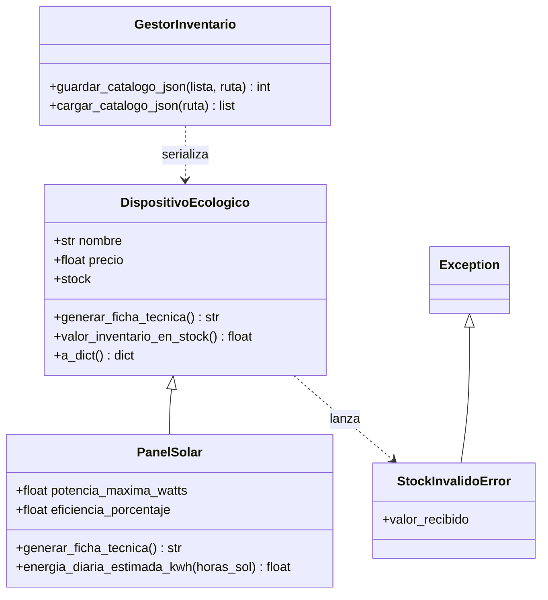

# Ejercicio 2 — Modelo de Productos, Excepciones y Persistencia

> **TP Final COM 2 · EcoTech Solutions — Equipamiento sustentable**

La división de equipamiento sustentable necesita gestionar el catálogo de
productos, impedir inconsistencias de inventario (stock negativo) mediante
validaciones de negocio y garantizar la persistencia del stock en disco.

---

## Archivos de este ejercicio

| Archivo | Qué contiene |
|---|---|
| `ejercicio_02_inventario.py` | Solución completa: Punto A (POO + excepciones) y Punto B (persistencia). |
| `test_ejercicio_02.py` | 24 tests unitarios con `unittest` (librería estándar). |
| `guia_de_estudio.md` | 10 preguntas del TP, con respuestas plegables. |
| `README.md` | Este documento: conceptos, diseño y modo de uso. |

## Cómo ejecutar

```bash
cd ejercicio_02_inventario

# Demostración completa (validación, polimorfismo y exportación a JSON):
python ejercicio_02_inventario.py

# Tests unitarios:
python -m unittest test_ejercicio_02.py -v
```

La demo genera `catalogo_ecotech.json` en la carpeta donde se corra (está en
`.gitignore` porque es un archivo que se produce solo al ejecutar).

Requisitos: **Python 3.10 o superior**. Cero dependencias externas.

---

## Conceptos clave

### 1. Encapsulamiento real con `@property`

El stock es el atributo crítico del inventario, así que lo protegí con una
property: el atributo real es `self._stock` (interno, por convención) y toda
lectura/escritura pasa por `stock`. El **setter** valida las reglas de negocio
y levanta `StockInvalidoError` si algo no cumple. El resultado: es
*imposible* que un objeto `DispositivoEcologico` tenga stock negativo, desde
afuera o desde adentro, porque hasta el constructor asigna pasando por la
property. Un solo punto de control (DRY).

### 2. Excepción personalizada

`StockInvalidoError` hereda de `Exception` y además guarda el
`valor_recibido` que disparó el error. Elegí una clase propia en vez de
`ValueError` para poder capturar *selectivamente* este error de negocio sin
atrapar otros errores numéricos.

### 3. Herencia y `super()`

`PanelSolar` hereda de `DispositivoEcologico`: reutiliza nombre/precio/stock,
la validación y todo el comportamiento común. En su `__init__` llama a
`super().__init__(...)` antes de agregar sus atributos técnicos
(`potencia_maxima_watts`, `eficiencia_porcentaje`). La validación de stock
también se hereda: un panel con stock negativo se rechaza igual.

### 4. Polimorfismo en la ficha técnica

`generar_ficha_tecnica()` existe en la base y se redefine en `PanelSolar`:
**misma firma, distinto comportamiento**. `GestorInventario` no necesita
saber qué clase concreta tiene en la lista: le pide `a_dict()` o la ficha a
cada objeto y Python ejecuta la versión correcta sola.

### 5. Serialización JSON y la clave "tipo"

JSON no entiende objetos Python, entonces cada clase sabe pasarse a dict con
`a_dict()`, que incluye la clave `"tipo"` con el nombre de su clase. Al leer
el archivo, `GestorInventario` usa ese registro de clases para reconstruir
cada instancia (round-trip: guardo → releo → recupero los mismos objetos).

### 6. UTF-8 explícito

Al escribir y leer el archivo uso siempre `encoding="utf-8"`. Sin eso,
Windows guarda con su codificación local y las tildes del catálogo se rompen
al abrir el archivo en otra máquina.

---

## Clases del dominio

| Clase | Responsabilidad |
|---|---|
| `StockInvalidoError` | Excepción de negocio: stock no entero o negativo. |
| `DispositivoEcologico` | Base del catálogo: datos comunes + stock encapsulado + ficha genérica. |
| `PanelSolar` | Especialización: atributos técnicos + ficha propia + cálculo de energía. |
| `GestorInventario` | Fábrica + persistencia: guardar/cargar el catálogo en JSON. |

## Diagrama de clases



---

## Decisiones de diseño (y sus alternativas)

| Decisión | Alternativa descartada | Por qué |
|---|---|---|
| Validar en el setter de la `@property` | Validar solo en `__init__` | Así el constructor también valida (pasa por la property) y nadie puede asignar un stock inválido después. |
| Una única excepción de dominio | Varias (`StockNegativoError`, `StockNoEnteroError`...) | Más simple de capturar; el mensaje y `valor_recibido` dan el detalle. |
| `a_dict()` polimórfico por clase | Serializar con `__dict__` genérico | `__dict__` incluye `_stock` y pierde el tipo; así el JSON queda limpio y reconstruible. |
| Clave `"tipo"` en el JSON | Guardar solo campos | Sin "tipo" no hay forma de saber qué constructor usar al leer. |
| `guardar_catalogo_json` devuelve la cantidad | No devolver nada | Sirve para el reporte de la demo y facilita testear. |
| `cargar_catalogo_json` como extra | Solo guardar (lo que pide el enunciado) | La persistencia quedó completa: lo escrito se puede recuperar. |
| `tempfile` en los tests | Escribir en la carpeta del repo | Los tests no ensucian el repo ni dependen del directorio actual. |

## Para seguir practicando

1. Validar también `eficiencia_porcentaje` (0–100) y `precio` (positivo).
2. Sumar una segunda subclase (ej: `TurbinaEolica`) y ver cómo el gestor la
   soporta agregando una sola línea al registro `CLASES`.
3. Agregar `modificar_stock(delta)` que permita sumar/restar sin violar la
   regla de negocio.
4. Manejar `FileNotFoundError` al cargar un catálogo que no existe.
5. Exportar también un resumen: total de productos, valor de inventario por
   tipo de dispositivo.
