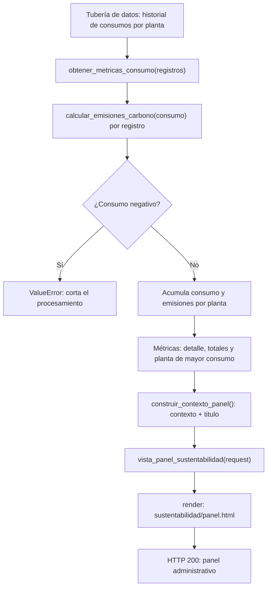

# Ejercicio 3 — Auditoría con Tests Unitarios e Integración Web

> **TP Final COM 2 · EcoTech Solutions**

Antes de poner el algoritmo de huella de carbono industrial en producción,
hay que certificarlo con pruebas automatizadas (auditoría) y después
integrarlo a la tubería de datos que alimenta el panel web administrativo.

---

## Archivos de este ejercicio

| Archivo | Qué contiene |
|---|---|
| `ejercicio_03_emisiones.py` | Algoritmo auditado, `obtener_metricas_consumo()` y demo del flujo (solo librería estándar). |
| `test_ejercicio_03.py` | 16 tests: `TestCalculoEmisiones` (Punto A) + pipeline + vista (se saltean sin Django). |
| `vista_django.py` | La vista `vista_panel_sustentabilidad(request)` (requiere Django). |
| `sustentabilidad/panel.html` | Plantilla Django del panel administrativo. |
| `guia_de_estudio.md` | 10 preguntas del TP, con respuestas plegables. |
| `README.md` | Este documento: conceptos, diseño y modo de uso. |

## Cómo ejecutar

```bash
cd ejercicio_03_emisiones

# Demostración completa (auditoría + métricas + render si hay Django):
python ejercicio_03_emisiones.py

# Tests unitarios:
python -m unittest test_ejercicio_03.py -v

# (Opcional) para que la vista Django renderice de verdad:
pip install django
```

Sin Django instalado, la auditoría, las métricas y 14 de los 16 tests
corren igual; solo los 2 tests de la vista se marcan `skipped`.

Requisitos: **Python 3.10 o superior**. Django **opcional** (solo capa web).

---

## Conceptos clave

### 1. Los tests como auditoría

Antes de integrar el algoritmo a producción, `TestCalculoEmisiones`
certifica sus dos conductas: la **exactitud numérica** (valores nominales,
factor por defecto y personalizado, consumo cero) y el **contrato de
excepción** (`ValueError` con consumos negativos, con el valor rechazado
en el mensaje). Cada test sigue el patrón AAA: *Arrange* (preparo), *Act*
(ejecuto), *Assert* (verifico).

### 2. Comparar floats con `assertAlmostEqual`

`0.4` y `0.2` no tienen representación binaria exacta, y los cálculos
arrastran colas de redondeo (en el historial, Sur acumula
`6380.200000000001`). Comparar con `==` o `assertEqual` produce falsos
fallidos; `assertAlmostEqual` compara con tolerancia y es LA forma
correcta de verificar resultados numéricos.

### 3. El algoritmo auditado alimenta el pipeline

`obtener_metricas_consumo()` acumula consumos por planta y le aplica
`calcular_emisiones_carbono()` a cada registro. Reusar el algoritmo
(y no recalcular a mano) es lo que garantiza que el panel muestre los
mismos números que certificó la auditoría: una sola fuente de verdad.

### 4. El contrato de excepción cruza todo el pipeline

Si un registro trae consumo negativo, el `ValueError` del algoritmo sube y
corta el procesamiento. Elegí NO capturarlo acá: mejor un panel que falla
ruidoso que un panel con números inventados. El test
`test_consumo_negativo_propaga_el_valueerror` fija esa decisión.

### 5. Vista delgada, lógica testeada

`construir_contexto_panel()` arma el contexto (y corre sin Django); la
vista `vista_panel_sustentabilidad(request)` solo lo toma y renderiza.
Ventaja: el armado del contexto se testea con unittest puro, y la parte
Django queda reducida a lo mínimo.

### 6. Django: contexto y plantilla

La vista devuelve `render(request, "sustentabilidad/panel.html", contexto)`.
La plantilla accede a las claves del contexto por nombre (`{{ titulo }}`,
``) y usa el filtro `floatformat:2` para
mostrar los números con 2 decimales. En los tests y la demo apunto el
motor de plantillas con `DIRS` a esta carpeta; en un proyecto real, la
carpeta `sustentabilidad/` iría dentro del `templates/` de la app.

### 7. Dependencias opcionales con `skipUnless`

Los tests de la vista usan
`@unittest.skipUnless(DJANGO_DISPONIBLE, ...)`: con Django instalado
corren y verifican HTTP 200 + el HTML; sin él, se marcan `skipped` y la
suite sigue verde. El import de Django va protegido con `try/except
ImportError`.

---

## Diagrama de flujo del pipeline



---

## Decisiones de diseño (y sus alternativas)

| Decisión | Alternativa descartada | Por qué |
|---|---|---|
| Validar por registro (no por subtotal) | Acumular y validar al final | Un `-100` y un `+100` no se cancelan: cada consumo inválido corta el pipeline. |
| Propagar el `ValueError` del algoritmo | Capturarlo y seguir | Un panel vacío avisa; un panel con datos inventados miente. |
| `construir_contexto_panel()` separada de la vista | Todo adentro de la vista | Testeable sin Django; la vista queda delgada. |
| Vista en archivo propio (`vista_django.py`) | Django directo en el módulo principal | El resto del TP sigue corriendo sin instalar Django. |
| `skipUnless` en los tests de la vista | Exigir Django para correr la suite | La auditoría es lo crítico y no depende de la web. |
| `assertAlmostEqual` en floats | `assertEqual` | Evita falsos fallidos por redondeo binario. |
| Historial simulado como constante | Consulta real a BD | Mismo flujo, cero infraestructura para la demo. |

## Para seguir practicando

1. Testear también el `factor_emision` negativo (hoy el algoritmo no lo
   valida: ¿debería ser `ValueError` también?).
2. Sumar un `factor_emision` por registro (cada planta con su matriz
   energética) y agregarlo al contrato de `obtener_metricas_consumo`.
3. Convertir la salida a toneladas de CO2e y formatear con `intcomma`.
4. Levantar el panel con `runserver` de un mini-proyecto Django y verlo en
   el navegador.
5. Agregar un test de la vista con historial vacío (el `` de la
   plantilla).
